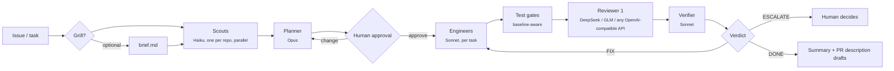

# Harness

**A multi-agent software delivery pipeline for [Claude Code](https://claude.com/claude-code), packaged as a plugin.**

Harness turns one Claude Code session into an engineering manager. It hands each part of the work to a
specialised agent: scouting, planning, implementation, an outside review by a model from a different
lab, and verification. It also enforces git guardrails and records the cost and outcome of every step,
so I can measure whether the pipeline is actually helping.

I use it daily on real projects, both single repos and multi-repo workspaces (for example an API plus
a mobile client).

---

## Why I built it

Coding agents are strong in a single session, but they don't behave like a team: they grade their own
work, run unattended near `git push`, and give you no data on what each step cost or whether it worked.
Harness is my answer to that:

- **Separation of roles.** The agent that writes the code never reviews it, and the reviewer is a model
  from a different lab (DeepSeek by default), so it's less likely to share the same blind spots.
- **Adversarial review with verification.** A second agent checks every review finding against the
  real code. It drops false positives and adjusts severities before anything goes back to the engineer.
- **Humans stay in control.** The plan needs my approval before any code is written. Subagents can't push,
  rewrite history or write to GitHub. The main session commits, pushes and edits PRs only as my personal
  GitHub account, after I've reviewed and asked. PR reviews from the harness go up only as *pending* reviews,
  which I submit myself.
- **Measured, not vibes.** Every stage logs tokens, cost, duration and outcome. `/harness-report`
  breaks down cost, quality and speed by stage and model.

## How it works



| Stage | Agent / model | What it does |
|---|---|---|
| Grill (optional) | Manager | Interviews me about scope, edge cases and "done", then writes `brief.md` |
| Scout | `scout` / Haiku | Read-only map of the relevant code in each repo, run in parallel |
| Plan | `planner` / Opus | Writes `plan.md` and a dependency-ordered `tasks.json` |
| Checkpoint | Me | Approve, change or abort the plan |
| Implement | `engineer` / Sonnet (Opus for hard tasks) | One task at a time, runs the test gates itself |
| Review | DeepSeek (falls back to an Opus `claude-reviewer`) | Cross-lab review of the diff against the plan |
| Verify | `verifier` / Sonnet | Confirms or rejects each finding and notes anything the reviewer missed |
| Verdict | `harness.py` (deterministic) | `DONE`, `FIX` (loop back) or `ESCALATE` to me after N rounds |

The manager session only passes file paths between stages and never reads diffs or source itself,
which keeps its context small over long runs.

## Engineering highlights

- **Deterministic core, agentic edges.** Everything that shouldn't be left to an LLM (run state,
  branching, gates, cost accounting, the review-loop decision, GitHub posting) lives in a single
  ~2.9k-line Python CLI ([`scripts/harness.py`](scripts/harness.py)). It uses **only the standard
  library**, so there's nothing to install.
- **Baseline-aware test gates.** Before any edits, Harness records the failures that already exist
  (jest, pytest, Django, tsc, eslint). Gates then fail only on *new* failures, so the pipeline works on
  real codebases whose test suites aren't green.
- **Enforced gates and test protection.** A `SubagentStop` hook keeps an engineer from finishing while a file it
  edited has no passing `gates` run on the current code (the run is tied to a hash of the working tree). `gates`
  also flags edits to pre-existing tests (removed or altered assertions, skips, deleted tests, loosened
  thresholds); the verifier must judge each flag before a run can be `DONE`.
- **Git guard hook.** A `PreToolUse` hook parses every shell command from the manager and all subagents.
  Subagents can never push or write to GitHub. What the main session can do depends on the gh login:
  - **Write account** (`[github] write_accounts`, default `Arbelaezch`, my personal account): commit, push,
    merge, cherry-pick, revert, tag, switch branches, stash, and every PR/issue write (create, merge, edit,
    comment, review). A project pinned to another account is not a write account.
  - **Any account:** the main session can `fetch` and `pull`; subagents can `fetch` but not `pull`.
  - **Any other account** (e.g. work): only create/switch branches, stash, `gh pr create` and
    `gh issue create`. No commit, push, merge or PR/issue edits.
  - **Always blocked:** history rewrites, force/deleting/mirror pushes, pushes or commits on protected
    branches, `gh auth switch`, token/host overrides, an unknown gh identity, and deleting repos or issues.

  The guard checks a command before any of it runs. In `git switch -c x && git add f && git commit ...` it
  follows the switch, because each step runs only if the previous one succeeded; after `;`, `||` or a pipe
  it checks the branch the repo is really on, so run the switch as its own command.

  It supports an `uncommitted` mode and a `commit` mode per project; the mode only governs subagents.
- **Pluggable outside reviewer.** Any OpenAI-compatible chat API works (DeepSeek, Z.ai GLM, OpenRouter).
  Cost tracking includes peak/off-peak pricing windows.
- **Cost ledger.** A `SubagentStop` hook parses each agent's transcript and prices its token usage
  (including cache reads/writes and long-context tiers). It reports API-equivalent cost on seat plans
  and real spend for outside providers.
- **Multi-repo PR review.** `/review-pr` finds linked PRs across repos, including dependency
  branches referenced in `package.json`. It reviews them together for contract mismatches and posts
  line-anchored *pending* GitHub reviews. In a legacy-profile project the Claude reviewer reviews (it can read
  models, contracts and consumers), a large PR set is split into parallel lenses (correctness, contracts, data,
  access), and only findings above the `[review_pr]` report bar reach the draft.
- **Multi-account aware.** A small shell wrapper plus a `SessionStart` hook make sure each project runs
  under the right Claude account and GitHub identity.

## Commands

| Command | |
|---|---|
| `/ship <issue or task>` | Full pipeline: optional grill, scouts, plan, approval, implementation, review loop, PR description drafts |
| `/ship --tier tiny\|standard\|large <task>` | Force a size tier; tiny skips grill and scouts, plans on Sonnet, one review round. `--quick` is an alias for tiny |
| `/review-pr <PR URL or repo#n>` | Reviews a PR plus the PRs it links to, then posts a **pending** GitHub review once I agree |
| `/harness-report` | Cost, quality and speed per stage and model |
| `/harness-init` | Set up or reconfigure the current project |

From a terminal, inside a project:

```sh
python3 scripts/harness.py doctor                   # check the setup
python3 scripts/harness.py models                   # which model each stage uses
python3 scripts/harness.py models set reviewer glm  # swap the outside reviewer
```

## Quick start

Requires [Claude Code](https://claude.com/claude-code), Python 3.11+ and the [GitHub CLI](https://cli.github.com/).

```sh
git clone https://github.com/Arbelaezch/software-factory.git ~/code/software-factory
echo 'source ~/code/software-factory/scripts/claude-accounts.sh' >> ~/.zshrc   # then open a new terminal

export DEEPSEEK_API_KEY=...   # optional; without it, reviews fall back to a Claude reviewer

cd ~/code/my-project          # one git repo, or a folder of repos
harness-setup                 # runs /harness-init, installs the plugin for this project, then closes
claude                        # /ship, /factory, /review-pr are ready
```

The plugin is installed per project (project scope), so it only loads in harness projects. A new folder
doesn't have `/harness-init` yet, so `harness-setup` (a shell command, typed in the terminal) starts a
one-off session that loads the plugin straight from this repo and runs `/harness-init`. That asks a few
questions, writes `.claude/harness.toml`, `.claude/settings.json` and a `CLAUDE.md`, installs the plugin
for the project's Claude account, and closes the session. Running `/harness-init` again inside a project
reconfigures it. You can also open `claude` in the new folder and ask it to set up the harness:
`harness accounts sync` puts a short note in each account's user-level `CLAUDE.md` telling sessions to
follow the `/harness-init` steps from this repo, since the plugin isn't loaded there yet. The same note
tells sessions about `harness plugin update`, so asking any session to update the plugins works.

After merging changes to the plugin, update every install (every project, every account) with
`python3 ~/code/software-factory/scripts/harness.py plugin update`, then restart open sessions.
`plugin list` shows each install and its version.

<details>
<summary><b>Optional: multiple Claude accounts</b></summary>

Add this to `~/.zshrc`:

```sh
source ~/code/software-factory/scripts/claude-accounts.sh
```

Plain `claude` then starts with the account the project asks for in `.claude/harness.toml`
(`[accounts] claude = "work"` or `"personal"`). Each account has its own config directory, set under
`[accounts.dirs]` in `scripts/defaults.toml`: personal is the default `~/.claude`, work is `~/.claude-work`.
Each directory keeps its own login, so a work session and a personal session can be open at once and
`/login` in one never changes the other. `claude-work`, `claude-personal` and `claude-as <name>` force a
specific one.

Setting up the work account once:

1. `claude-work`, then `/login` with the work account. `/status` shows which email a session uses.
2. `harness accounts sync` copies the shared user settings (hooks, including the GitHub guard, statusline,
   permissions, notifications; the list is `[accounts] shared_settings`) from `~/.claude/settings.json` to
   the other account directories. Run it again after changing `~/.claude/settings.json`.
3. The plugin is installed per project under the project's account: `harness-setup` does it for new
   projects, and `harness plugin install` inside a project does it for an existing one.
   `harness plugin update` updates the installs of every account.

`harness accounts` lists every account with its directory, signed-in email and settings drift, and
`harness doctor` does the same for the project's account (plus whether the plugin is installed for it).
Both warn when two directories are signed in to the same account.

The wrapper only applies to `claude` started from a terminal. The desktop app, IDE extensions and folders
without a harness config always use `~/.claude`, so they are always on the personal account. The
session-start hook warns when a session is on a different account than its project asks for.
</details>

<details>
<summary><b>Optional: factory blockers on your phone (Telegram)</b></summary>

The factory's questions and blockers can reach your phone, and you answer them there. Set it up once per machine;
every project and every Claude or GitHub account shares the one bot. They are sent only in a remote run: start it
with `factory start --remote` (or tell `/factory` you are heading out), or switch a running one with
`factory set remote on|off`, which applies to the next blocker. Without it they stay in the `/factory` session.

1. In Telegram, message [@BotFather](https://t.me/BotFather): `/newbot`, then copy the token. In its bot settings,
   turn on topics (threaded mode), so each project gets its own thread.
2. Send your new bot any message.
3. Run `python3 ~/code/software-factory/scripts/harness.py phone setup --token <token>`, then `phone test` in a project.

A message leads with a plain-language summary; each option arrives as a button with a short label, and **Details**
shows the full message with its file paths and logs. Tap an option, or reply to the message ("2, but keep the old
endpoint", or a question like "why did CI fail?"). A short Sonnet session in that project records the answer and
resumes the issue, or answers the question; the message is then edited to show your choice, the time and whether the
issue runs again. Send `status` in a project's topic for that project, or outside the topics for all of them.

You are asked about the product, and about implementation or process only when it matters: minor questions of those
two kinds are settled by the factory with its recommended option and arrive as a silent one-line note you can reply
to and overrule (`[factory] auto_accept`, `[]` to be asked everything). A blocker with nothing to decide (the
factory's own tooling is in the way) arrives as a report, not a question.
`harness phone status` shows the bridge and what is waiting; `[factory] remote = true` makes every run of a project remote.
See section 7 of [`docs/factory-design.md`](docs/factory-design.md).
</details>

<details>
<summary><b>Optional: plan-usage check (statusline)</b></summary>

`scripts/usage.py` reports how much of the 5-hour and weekly plan windows is used and returns go, pause
(with the time to resume) or unknown. It reads a snapshot written by `scripts/statusline_capture.py`, so
the statusline command has to be set. This is a local setting, not part of the plugin. Add it to
`~/.claude/settings.json`:

```json
"statusLine": {
  "type": "command",
  "command": "python3 ~/code/software-factory/scripts/statusline_capture.py"
}
```

(Use the full path if `~` is not expanded.) The snapshot is saved to `statusline-latest.json` in the
session's config directory (`~/.claude`, or the account's directory with multiple accounts), so each
account has its own, and it only updates while a Claude Code session on that account is open. When it is
missing or older than 5 minutes, `usage.py` takes a fresh reading with a one-turn headless run on the same
account instead. `usage.py` reads `$CLAUDE_CONFIG_DIR` (else `~/.claude`), or `--config-dir`; the factory
always checks the project's account. Run `python3 scripts/usage.py` (exit code 0 go, 10 pause, 2 unknown;
`--json` for details). See [`docs/factory-design.md`](docs/factory-design.md) for how it fits the planned factory.
</details>

<details>
<summary><b>Per-project config: <code>.claude/harness.toml</code></b></summary>

- `[project]`: `name`, `description`, `review_focus` (checks that reviewers make on every review).
- `[accounts]`: `claude` (account name), `github` (gh user; the token comes from `gh auth token --user`),
  `git_email` (doctor warns when a repo commits as someone else).
- `[github]`: `write_accounts`, the gh logins that can commit, push and write to PRs/issues (default `["Arbelaezch"]`; any other, e.g. a work login, can only create PRs and issues and work with local branches).
- `[git]`: `base_branch`, `mode = "uncommitted" | "commit"` (what subagents may do; committing as a subagent also needs a `write_accounts` login).
- `[repos.<name>]`: `path`, `description`, `gates = [{ name, kind, cmd, cwd }]`, where `kind` is
  jest, pytest, django, tsc or eslint.
- `[repos.<name>.contracts]` (optional, for a repo that serves an API to other repos): `map_cmd` writes a contract
  map (endpoints, fields, consumers) to `{out}`, rebuilt by `harness contracts map` only when a file under `covers`
  (pathspecs; `"<repo>:<pathspec>"` for another repo) changed since it was built. Scouts and the planner read it.
  `snapshot_cmd` writes the contract (fields and status codes per endpoint) to `{out}`: `harness baseline` takes a
  snapshot before any edits and the `contracts` gate takes another and diffs them, so nothing is committed to the repo.
  `cwd` is where the commands run. The plan must declare every contract change with a consumer task, reviewers get
  the contract diff, and an undeclared change fails the gate and is a blocking finding.
- `[knowledge.<name>]` (optional): a reference file generated from the code, such as a Django model map, that
  scouts, the planner and engineers read instead of opening the files it covers. `repo` and `cwd` say where `cmd`
  runs; `cmd` writes Markdown to `{out}`; `covers` lists the pathspecs it is built from (`"<repo>:<pathspec>"` for
  another repo; default the whole repo); `description` is one line telling agents what it lists. `harness knowledge`
  (run by /ship before scouting) rebuilds it only when a covered path changed since the commit recorded in its stamp,
  and writes `<run_dir>/knowledge.md` for the agents. `harness report --tools` counts reads of covered files per run.
- `[ship]` (optional): `profile = "legacy"` for a large codebase where the nearest code is often a pattern to avoid
  (retiring or dead code next to live code). The grill always runs (except tiny) and asks only about product
  behaviour and important trade-offs the project's `decision_docs` don't settle; scouts report each file's class
  (from `classification`), the live code to copy and the `traps` that apply; every plan task cites the code it
  follows and the plan lists its departures from local convention for approval; engineers stop at traps the plan
  didn't expect; reviewers check against the cited examples and the traps. With the default `"standard"`, nothing changes.
- `.claude/classification.toml` (optional, any profile): path globs from the project root mapped to a class, one
  `[<rule name>]` table each with `class` (`live`, `legacy`, `dead` or `dangerous`), `paths` and `message`. The first
  matching rule wins, so `live` exceptions go above the rule they carve out. The guard hook checks every Edit/Write:
  a `dead` or `dangerous` path is denied for subagents (the main session asks you) unless a plan task lists it under
  `allow_classified`; a `legacy` path gets the message as a warning, where `{1}`, `{2}`... are the parts the
  wildcards matched (e.g. `"Live equivalent: {1}/api/"`). Globs support `*`, `**`, `?` and `{a,b}`; a folder covers
  everything under it. Scouts get the rules in profile.md, `harness classify <path>...` prints a file's class, and
  `harness doctor` checks the file. Edits made through Bash are not checked.
- Any section from [`scripts/defaults.toml`](scripts/defaults.toml) can be overridden, such as
  `[reviewer]`, `[models]`, `[loop]` or `[providers.*]`.

Run state and metrics live in `.harness/` in the project, which is excluded from git automatically. The factory's run files in `.factory/` are excluded the same way (in the local `.git/info/exclude`), except `docs.json`, which you can commit, and `decisions.md`, which the factory commits for you: new answers go to `decisions.pending.md` (never in git) and the factory moves them into `decisions.md` on the base branch between issues (through a pull request when the branch is protected). Gitignore `.factory/decisions.md` to keep decisions out of git altogether. `harness report --tools` shows where context goes; see `docs/context-cost.md`.
</details>

## Repository layout

```
.claude-plugin/   plugin + marketplace manifests
agents/           subagent definitions: scout, planner, engineer, claude-reviewer, verifier
skills/           slash commands: /ship, /review-pr, /harness-init, /harness-report
hooks/hooks.json  git guard, per-agent metrics, account check
scripts/          harness.py (CLI), defaults.toml, claude-accounts.sh, usage.py, statusline_capture.py, phone.py
docs/             factory-design.md (planned factory layer), factory-allowlist.md (per-repo command allow list)
```

## Author

**Christian Arbelaez** · [github.com/Arbelaezch](https://github.com/Arbelaezch)
