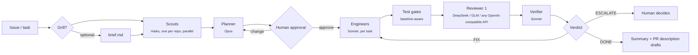

# Harness

**A multi-agent software delivery pipeline for [Claude Code](https://claude.com/claude-code), packaged as a plugin.**

Harness turns one Claude Code session into an engineering manager. It hands each part of the work to a
specialised agent: scouting, planning, implementation, an outside review by a model from a different lab, and
verification. It enforces git guardrails and records the cost and outcome of every step. The factory layer on
top runs that pipeline over a queue of GitHub issues, unattended.

I use it daily on real projects, both single repos and multi-repo workspaces.

## Why I built it

Coding agents are strong in a single session, but they don't behave like a team: they grade their own work, run
unattended near `git push`, and give you no data on what each step cost or whether it worked.

- **Separation of roles.** The agent that writes the code never reviews it, and the reviewer is a model from a
  different lab (DeepSeek by default).
- **Review with verification.** A second agent checks every review finding against the real code and drops
  false positives before anything goes back to the engineer.
- **Humans stay in control.** In `/ship` the plan needs my approval before any code is written. Subagents can't
  push, rewrite history or write to GitHub. PR reviews go up only as *pending* reviews, which I submit myself.
- **Measured.** Every stage logs tokens, cost, duration and outcome; `/harness-report` breaks them down.

## How it works



| Stage | Agent / model | What it does |
|---|---|---|
| Grill (optional) | Manager | Interviews me about scope, edge cases and "done", then writes `brief.md` |
| Scout | `scout` / Haiku | Read-only map of the relevant code in each repo, run in parallel |
| Plan | `planner` / Opus | Writes `plan.md` and a dependency-ordered `tasks.json` |
| Checkpoint | Me | Approve, change or abort the plan |
| Implement | `engineer` / Sonnet (Opus for hard tasks) | One task at a time, runs the test gates itself |
| Review | DeepSeek (falls back to an Opus `claude-reviewer`) | Cross-lab review of the diff against the plan |
| Verify | `verifier` / Sonnet | Confirms or rejects each finding and notes anything the reviewer missed |
| Verdict | `harness.py` (deterministic) | `DONE`, `FIX` (loop back) or `ESCALATE` to me after N rounds |

The manager session only passes file paths between stages and never reads diffs or source itself, which keeps
its context small over long runs.

**The factory** (`/factory`) runs this pipeline without the human checkpoints: a detached supervisor starts a
fresh headless session per queued issue, opens the PR, waits for CI and merges. It pauses when plan usage runs
out and comes to me only for questions that are mine to decide. See [`docs/factory-design.md`](docs/factory-design.md).

## Commands and flags

### Slash commands

| Command | What it does |
|---|---|
| `/ship <issue URL \| repo#n \| task>` | Full pipeline: optional grill, scouts, plan, approval, implementation, review loop, PR description drafts |
| `/factory [what you want]` | Talk to the factory in plain language: "work on 12 and 13", "status", "stop" |
| `/factory-plan <MVP doc>` | Checks the project documents are clear enough to build from, then creates the GitHub issues |
| `/review-pr <PR URL \| repo#n>` | Reviews a PR plus the PRs it links to, then creates a **pending** GitHub review |
| `/harness-report` | Cost, quality and speed per stage and model |
| `/harness-init` | Set up or reconfigure the current project |

### `/ship` flags

| Flag | Effect |
|---|---|
| `--tier tiny\|standard\|large` | Force a size tier. Tiny skips grill and scouts, plans on Sonnet and does one review round |
| `--quick` | Alias for `--tier tiny` |
| `--grill` / `--no-grill` | Force the grill interview on or off (otherwise it asks) |

### Factory flags

In `/factory` you say these in plain language; it runs `harness factory start` with the matching flags. All are
off by default and apply to that run only.

| Flag | Say something like | Effect |
|---|---|---|
| `--issues 12,13` | "work on 12 and 13" | Queue these issues and run them. Without it, runs what is already labelled `todo` |
| `--merge manual` | "let me merge" | Leave PRs open for me. Default `auto`: wait for CI, one fix attempt, squash-merge |
| `--until-limit` | "use all my usage" | Ignore the usage caps (85% of the 5-hour window, 90% weekly); pause only at the plan limit itself |
| `--auto-queue` | "keep yourself busy" | When the queue is empty, queue planned and backlog issues, then discover new ones from the MVP documents. Needs `--merge auto` |
| `--nighttime` | "run overnight" | Keep going through hours of unreadable plan usage instead of stopping after 30 minutes |
| `--remote` | "I'm heading out" | Also send questions and blockers to my phone (Telegram). Without it they stay in the `/factory` session |
| `--max-issues N` | | Most issues one run works on (default 20) |

Switch a setting while the factory runs, without restarting it:

```sh
harness factory set <nighttime|auto-queue|until-limit|remote> <on|off>
```

`nighttime`, `auto-queue` and `until-limit` apply before the next issue. `remote` applies to the next blocker,
including one from the issue in progress. `harness factory status` shows the current settings, and
`harness factory stop` stops after the current issue (`--now`: immediately).

### Other flags

| Command | Flag | Effect |
|---|---|---|
| `/review-pr` | `--only` | Review just this PR, without discovering linked PRs |
| `/factory-plan` | `--vision <path>` | A vision document to read with the MVP |
| `/harness-report` | `--days N` | Period to cover (default 30) |
| `/harness-report` | `--run RUN_ID` | One run only |
| `harness report` | `--tools` | Where context goes, per tool (see [`docs/context-cost.md`](docs/context-cost.md)) |
| `harness report` | `--csv <file>` | Export the raw events |

### From a terminal

`harness` below is `python3 ~/code/software-factory/scripts/harness.py`, run inside a project.

```sh
harness doctor                     # check the setup
harness models                     # which model each stage uses
harness models set reviewer glm    # swap the outside reviewer
harness plugin update              # update every install after merging plugin changes
harness phone status               # the Telegram bridge and what is waiting
```

## Quick start

Requires [Claude Code](https://claude.com/claude-code), Python 3.11+ and the [GitHub CLI](https://cli.github.com/).

```sh
git clone https://github.com/Arbelaezch/software-factory.git ~/code/software-factory
echo 'source ~/code/software-factory/scripts/claude-accounts.sh' >> ~/.zshrc   # then open a new terminal

export DEEPSEEK_API_KEY=...   # optional; without it, reviews fall back to a Claude reviewer

cd ~/code/my-project          # one git repo, or a folder of repos
harness-setup                 # runs /harness-init, installs the plugin for this project, then closes
claude                        # /ship, /factory, /review-pr are ready
```

The plugin is installed per project, so it only loads in harness projects. `harness-setup` is a shell command:
it starts a one-off session that asks a few questions, writes `.claude/harness.toml`, `.claude/settings.json`
and a `CLAUDE.md`, installs the plugin for the project's Claude account, and closes. You can also open `claude`
in a new folder and ask it to set up the harness. Run `/harness-init` inside a project to reconfigure it.

After merging changes to the plugin, run `harness plugin update` (every project, every account), then restart
open sessions. `harness plugin list` shows each install and its version.

<details>
<summary><b>Optional: multiple Claude accounts</b></summary>

With `claude-accounts.sh` sourced in `~/.zshrc`, plain `claude` starts with the account the project asks for in
`.claude/harness.toml` (`[accounts] claude = "work"` or `"personal"`). Each account has its own config directory
(`[accounts.dirs]` in `scripts/defaults.toml`: personal is `~/.claude`, work is `~/.claude-work`) and its own
login, so both can be open at once. `claude-work`, `claude-personal` and `claude-as <name>` force one.

Setting up the work account once:

1. `claude-work`, then `/login` with the work account. `/status` shows which email a session uses.
2. `harness accounts sync` copies the shared user settings (hooks, statusline, permissions, notifications; the
   list is `[accounts] shared_settings`) from `~/.claude/settings.json` to the other account directories. Run it
   again after changing that file.
3. Install the plugin per project under the project's account: `harness-setup` for a new project,
   `harness plugin install` inside an existing one.

`harness accounts` lists every account with its directory, signed-in email and settings drift. The wrapper only
applies to `claude` started from a terminal: the desktop app, IDE extensions and folders without a harness config
always use `~/.claude`. The session-start hook warns when a session is on a different account than its project
asks for.
</details>

<details>
<summary><b>Optional: factory blockers on your phone (Telegram)</b></summary>

In a remote run (`--remote`, `factory set remote on`, or `[factory] remote = true` for every run of a project)
the factory's questions and blockers also reach your phone, and you answer them there. Set it up once per
machine; every project and account shares the one bot.

1. In Telegram, message [@BotFather](https://t.me/BotFather): `/newbot`, then copy the token. In its bot settings,
   turn on topics (threaded mode), so each project gets its own thread.
2. Send your new bot any message.
3. Run `harness phone setup --token <token>`, then `harness phone test` in a project.

Each option arrives as a button, and **Details** shows the full message. Tap an option, or reply in your own
words ("2, but keep the old endpoint", or a question like "why did CI fail?"). A short Sonnet session in that
project records the answer and resumes the issue. Send `status` in a project's topic for that project, or outside
the topics for all of them.

Minor implementation and process questions are settled by the factory with its recommended option and arrive as
a silent note you can reply to and overrule (`[factory] auto_accept`; `[]` to be asked everything). See section 7
of [`docs/factory-design.md`](docs/factory-design.md).
</details>

<details>
<summary><b>Optional: plan-usage check (statusline)</b></summary>

The factory pauses on plan usage, which it reads from a snapshot written by `scripts/statusline_capture.py`. This
is a local setting, not part of the plugin. Add it to `~/.claude/settings.json`:

```json
"statusLine": {
  "type": "command",
  "command": "python3 ~/code/software-factory/scripts/statusline_capture.py"
}
```

The snapshot is saved per account and only updates while a Claude Code session on that account is open. When it
is missing or older than 5 minutes, `usage.py` takes a fresh reading with a one-turn headless run instead.
`python3 scripts/usage.py` prints the decision (exit code 0 go, 10 pause, 2 unknown; `--json` for details).
</details>

<details>
<summary><b>Per-project config: <code>.claude/harness.toml</code></b></summary>

Any section of [`scripts/defaults.toml`](scripts/defaults.toml) can be overridden (`[reviewer]`, `[models]`,
`[loop]`, `[factory]`, `[providers.*]`...). The project-specific ones:

| Section | Keys |
|---|---|
| `[project]` | `name`, `description`, `review_focus` (checks reviewers make on every review) |
| `[accounts]` | `claude` (account name), `github` (gh user), `git_email` (doctor warns when a repo commits as someone else) |
| `[github]` | `write_accounts`: the gh logins that can commit, push and write to PRs/issues (default `["Arbelaezch"]`) |
| `[git]` | `base_branch`, `mode = "uncommitted" \| "commit"` (what subagents may do) |
| `[repos.<name>]` | `path`, `description`, `gates = [{ name, kind, cmd, cwd }]`; `kind` is jest, pytest, django, tsc or eslint |
| `[repos.<name>.contracts]` | Optional, for a repo that serves an API to other repos. `map_cmd` writes a contract map for scouts and the planner; `snapshot_cmd` lets the `contracts` gate diff the contract before and after, so an undeclared change fails the gate |
| `[knowledge.<name>]` | Optional. A reference file generated from the code (`cmd`, `covers`, `description`), such as a model map, that agents read instead of opening the files it covers. Rebuilt only when a covered path changed |
| `[ship]` | Optional. `profile = "legacy"` for a large codebase where nearby code is often a pattern to avoid: the grill always runs, every plan task cites the live code it follows, and reviewers check against it |

`.claude/classification.toml` (optional) maps path globs to a class (`live`, `legacy`, `dead` or `dangerous`),
one `[<rule name>]` table each with `class`, `paths` and `message`; the first matching rule wins. The guard hook
denies subagent edits to `dead` and `dangerous` paths unless a plan task allows them, and warns on `legacy` ones.
`harness classify <path>...` prints a file's class.

Run state and metrics live in `.harness/`, and the factory's run files in `.factory/`; both are excluded from git
automatically. The exceptions are `.factory/docs.json`, which you can commit, and `.factory/decisions.md`, which
the factory commits for you on the base branch between issues (gitignore it to keep decisions out of git).
</details>

## Engineering highlights

- **Deterministic core, agentic edges.** Everything that shouldn't be left to an LLM (run state, branching,
  gates, cost accounting, the review-loop decision, GitHub posting) lives in one Python CLI
  ([`scripts/harness.py`](scripts/harness.py)) that uses only the standard library.
- **Baseline-aware test gates.** Harness records the failures that already exist before any edits, so gates fail
  only on *new* failures and the pipeline works on codebases whose suites aren't green.
- **Enforced gates and test protection.** A `SubagentStop` hook keeps an engineer from finishing while a file it
  edited has no passing gates run on the current code. Edits that weaken pre-existing tests are flagged, and the
  verifier must judge each flag before a run can be `DONE`.
- **Git guard hook.** A `PreToolUse` hook parses every shell command from the manager and all subagents:
  - **Subagents** can never push or write to GitHub.
  - **Write account** (`[github] write_accounts`, my personal account): the main session can commit, push, merge
    and write to PRs and issues.
  - **Any other account** (e.g. work): only create and switch branches, stash, `gh pr create` and `gh issue create`.
  - **Always blocked:** history rewrites, force or deleting pushes, pushes or commits on protected branches,
    `gh auth switch`, token overrides, and deleting repos or issues.
- **Pluggable outside reviewer.** Any OpenAI-compatible chat API works (DeepSeek, Z.ai GLM, OpenRouter).
- **Cost ledger.** A hook prices each agent's token usage from its transcript, including cache reads and writes.
- **Multi-repo PR review.** `/review-pr` finds linked PRs across repos, reviews them together for contract
  mismatches and posts line-anchored *pending* GitHub reviews.
- **Multi-account aware.** A shell wrapper plus a `SessionStart` hook make sure each project runs under the right
  Claude account and GitHub identity.

## Repository layout

```
.claude-plugin/   plugin + marketplace manifests
agents/           subagent definitions (scout, planner, engineer, verifier, the factory's agents...)
skills/           slash commands: /ship, /factory, /factory-plan, /review-pr, /harness-init, /harness-report
hooks/hooks.json  git guard, per-agent metrics, account check
scripts/          harness.py (CLI), factory_loop.py, phone.py, usage.py, defaults.toml, claude-accounts.sh
docs/             factory-design.md, factory-allowlist.md (per-repo command allow list), context-cost.md
tests/            run with python3 -m pytest -q
```

## Author

**Christian Arbelaez** · [github.com/Arbelaezch](https://github.com/Arbelaezch)
